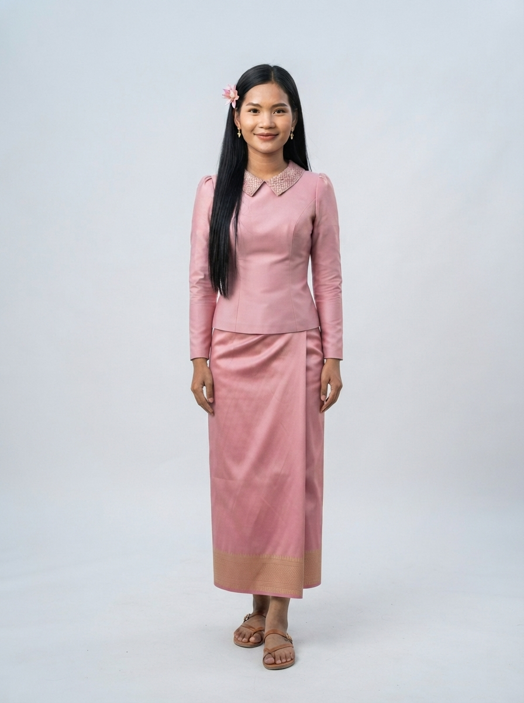

# 03 · Battambang (បាត់ដំបង)

| | |
|---|---|
| **Song** | បាត់ដំបងបណ្ដូលចិត្ត (Battambang, Beloved), 3:30, funky 80s synth-pop |
| **Avatar** | a fictional AI avatar (name to be chosen): a confident young Khmer woman from Battambang. She represents the province in anything: singer, tour guide, assistant, host, ambassador |
| **Status** | ✅ avatar picked (look D), lyrics checked, guide facts drafted (to verify) |

 

> ⚠️ **AI disclosure:** this avatar, her voice and every image here are AI-generated. She is fictional and does not
> show any real person. The song was **made with Suno** (see [song/rights.txt](./song/rights.txt)).

## The song
Cambodia's rice bowl and land of art: the old French-era town, mee kola and local oranges, the bamboo train, Phnom
Banan, the bat cave at Phnom Sampov, lotus at Kamping Puoy and sunsets on the Sangke river. Listen:
[song/battambang-beloved.mp3](./song/battambang-beloved.mp3). Lyrics: [song/lyrics.txt](./song/lyrics.txt).

## The avatar
She is the face of Battambang and can represent the province in anything: she sings its song, guides visitors,
answers questions, and hosts its events, lessons, campaigns and local products. Her look is lotus-pink Khmer silk by
the river at sunset. Her guide facts are in [province.md](./province.md); her profile and rules are in
[avatar/profile.md](./avatar/profile.md).

## Files
- `avatar/`: face reference, full-body sheet, approved look, prompts, profile, `avatar.json`. To use her in new images
  (same face, any outfit), follow [../SKILL.md](../SKILL.md).
- `province.md`: guide and assistant facts (places, food, travel, responsible tourism)
- `song/`: the song MP3 (as exported from Suno), lyrics (as given to Suno and spelling-corrected), rights record

## How to reuse
Everything here is licensed **CC BY 4.0** ([../LICENSE-MEDIA](../LICENSE-MEDIA)). Credit:
"CamboVerse Provinces — Battambang, CamboVerse Center (CC BY 4.0). AI-generated character; song made with Suno."
Keep the AI disclosure when you republish her image. Do not present her as a real person, and use her only for
Battambang. Never use her for a political party, candidate or cause, or for alcohol, tobacco, gambling or weapons (full
rules: [../SKILL.md](../SKILL.md)).
