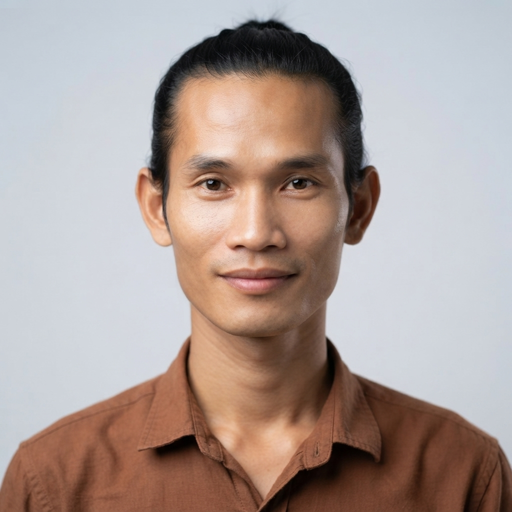
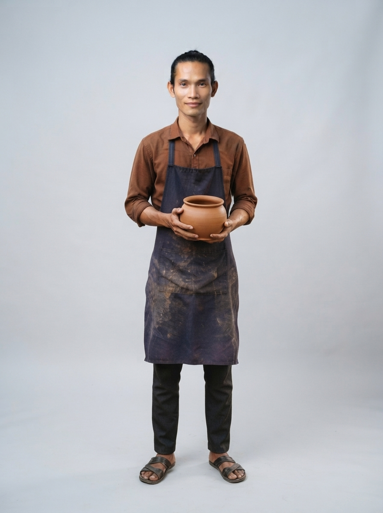

# 05 · Kampong Chhnang (កំពង់ឆ្នាំង)

| | |
|---|---|
| **Song** | កំពង់ឆ្នាំង ទឹកដីសិប្បកម្ម (Kampong Chhnang, Land of Crafts), 4:40, uplifting folk-pop with khloy, tro sau and clay percussion |
| **Avatar** | **Vichea (វិជ្ជា)**, a fictional AI avatar: a young potter from Kampong Chhnang. He represents the province in anything: singer, tour guide, assistant, host, ambassador |
| **Status** | ✅ avatar picked (look A), lyrics checked, guide facts drafted (to verify) |

 

> ⚠️ **AI disclosure:** Vichea, his voice and every image here are AI-generated. He is fictional and does not
> show any real person. The song was **made with Suno** (see [song/rights.txt](./song/rights.txt)).

## The song
An invitation to the land of pottery: smoke from the kilns over the villages, clay pots shaped by hand, the floating
villages, Phnom Neang Kangrei and its legend, sunsets on the water and fresh river fish. Listen:
[song/kampong-chhnang-land-of-crafts.mp3](./song/kampong-chhnang-land-of-crafts.mp3). Lyrics:
[song/lyrics.txt](./song/lyrics.txt).

## Vichea
He is the face of Kampong Chhnang and can represent the province in anything: he sings its song, guides visitors,
answers questions, and hosts its events, lessons, campaigns and local products. His look is a young potter in his
village's pottery yard. His guide facts are in [province.md](./province.md); his profile and rules are in
[avatar/profile.md](./avatar/profile.md).

## Files
- `avatar/`: face reference, full-body sheet, approved look, prompts, profile, `avatar.json`. To use him in new images
  (same face, any outfit), follow [../SKILL.md](../SKILL.md).
- `province.md`: guide and assistant facts (places, food, travel, responsible tourism)
- `song/`: the song MP3 (as exported from Suno), lyrics (as given to Suno and spelling-corrected), rights record

## How to reuse
Everything here is licensed **CC BY 4.0** ([../LICENSE-MEDIA](../LICENSE-MEDIA)). Credit:
"Vichea, CamboVerse Provinces — Kampong Chhnang, CamboVerse Center (CC BY 4.0). AI-generated character; song made with Suno."
Keep the AI disclosure when you republish his image. Do not present him as a real person, and use him only for
Kampong Chhnang. Never use him for a political party, candidate or cause, or for alcohol, tobacco, gambling or weapons
(full rules: [../SKILL.md](../SKILL.md)).
