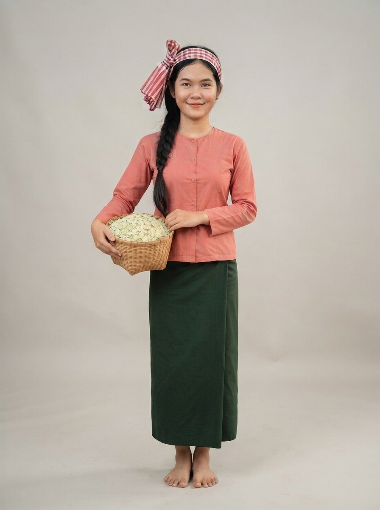

# 07 · Kampong Thom (កំពង់ធំ)

| | |
|---|---|
| **Song** | កំពង់ធំជម្រំចិត្ត (Kampong Thom, Shelter of the Heart), 4:05, bright Khmer bedroom-pop with roneat |
| **Avatar** | a fictional AI avatar (name to be chosen): a cheerful young Khmer woman from Kampong Thom. She represents the province in anything: singer, tour guide, assistant, host, ambassador |
| **Status** | ✅ avatar picked (look D), lyrics checked, guide facts drafted (to verify) |

 

> ⚠️ **AI disclosure:** this avatar, her voice and every image here are AI-generated. She is fictional and does not
> show any real person. The song was **made with Suno** (see [song/rights.txt](./song/rights.txt)).

## The song
A road trip up National Road 6: Phnom Santuk, the elephant-and-tiger statue, Sambor Prei Kuk, the Stung Sen river,
Phat Sanday floating village, and ambok, prahok and nom banh chok. Listen:
[song/kampong-thom-shelter-of-the-heart.mp3](./song/kampong-thom-shelter-of-the-heart.mp3). Lyrics: [song/lyrics.txt](./song/lyrics.txt).

## The avatar
She is the face of Kampong Thom and can represent the province in anything: she sings its song, guides visitors,
answers questions, and hosts its events, lessons, campaigns and local products. Her look is a village harvest: a
red-and-white krama headband, a coral blouse, a green sarong and a basket of fresh ambok. Her guide facts are in
[province.md](./province.md); her profile and rules are in [avatar/profile.md](./avatar/profile.md).

## Files
- `avatar/`: face reference, full-body sheet, approved look, `looks/` for other outfits, prompts, profile, `avatar.json`.
  To use her in new images (same face, any outfit), follow [../SKILL.md](../SKILL.md).
- `province.md`: guide and assistant facts (places, food, travel, responsible tourism)
- `song/`: the song MP3 (as exported from Suno), lyrics (as given to Suno and spelling-corrected), rights record

## How to reuse
Everything here is licensed **CC BY 4.0** ([../LICENSE-MEDIA](../LICENSE-MEDIA)). Credit:
"CamboVerse Provinces — Kampong Thom, CamboVerse Center (CC BY 4.0). AI-generated character; song made with Suno."
Keep the AI disclosure when you republish her image. Do not present her as a real person, and use her only for Kampong
Thom. Never use her for a political party, candidate or cause, or for alcohol, tobacco, gambling or weapons (full
rules: [../SKILL.md](../SKILL.md)).
