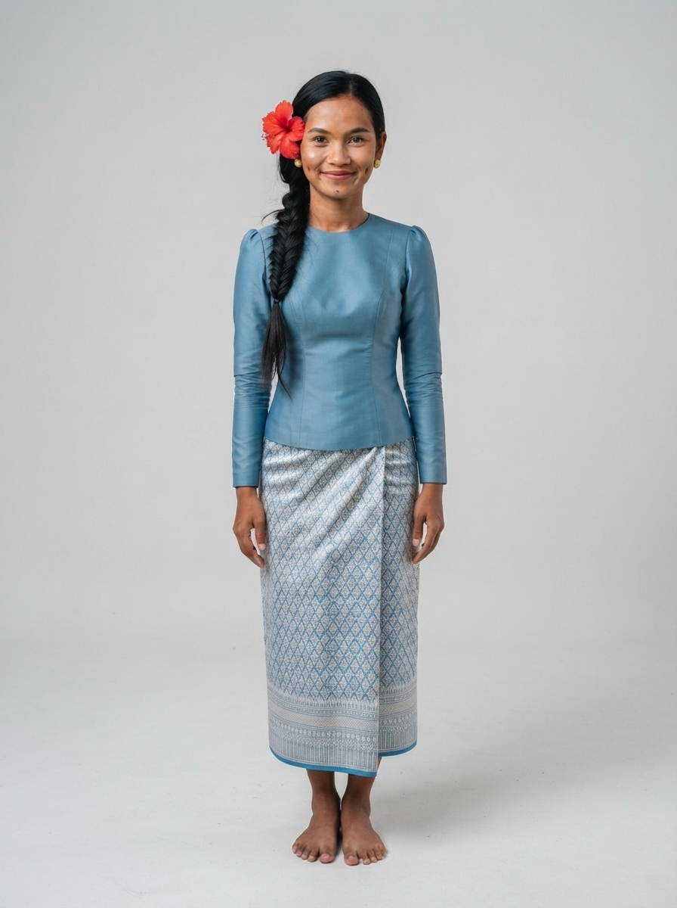

# 10 · Kep (កែប)

| | |
|---|---|
| **Song** | កែប ក្ដាមឆ្ងាញ់ (Kep, Delicious Crab), 4:11, sunny seaside folk-pop with khloy flute |
| **Avatar** | a fictional AI avatar (name to be chosen): a bright, playful young Khmer woman from Kep. She represents the province in anything: singer, tour guide, assistant, host, ambassador |
| **Status** | ✅ avatar picked (look D), lyrics checked, guide facts drafted (to verify) |

 

> ⚠️ **AI disclosure:** this avatar, her voice and every image here are AI-generated. She is fictional and does not
> show any real person. The song was **made with Suno** (see [song/rights.txt](./song/rights.txt)).

## The song
A sunny seaside invitation: the sea breeze, the crab statue, the busy crab market, crab with green pepper, Rabbit
Island, coral, sunsets and Kep hill. Listen: [song/kep-delicious-crab.mp3](./song/kep-delicious-crab.mp3). Lyrics:
[song/lyrics.txt](./song/lyrics.txt).

## The avatar
She is the face of Kep and can represent the province in anything: she sings its song, guides visitors, answers
questions, and hosts its events, lessons, campaigns and local products. Her look is sea-blue silk on a beach deck at
sunset, with crab and green pepper on the table. Her guide facts are in [province.md](./province.md); her profile and
rules are in [avatar/profile.md](./avatar/profile.md).

## Files
- `avatar/`: face reference, full-body sheet, approved look, prompts, profile, `avatar.json`. To use her in new images
  (same face, any outfit), follow [../SKILL.md](../SKILL.md).
- `province.md`: guide and assistant facts (places, food, travel, responsible tourism)
- `song/`: the song MP3 (as exported from Suno), lyrics (as given to Suno and spelling-corrected), rights record

## How to reuse
Everything here is licensed **CC BY 4.0** ([../LICENSE-MEDIA](../LICENSE-MEDIA)). Credit:
"CamboVerse Provinces — Kep, CamboVerse Center (CC BY 4.0). AI-generated character; song made with Suno."
Keep the AI disclosure when you republish her image. Do not present her as a real person, and use her only for Kep.
Never use her for a political party, candidate or cause, or for alcohol, tobacco, gambling or weapons (full rules:
[../SKILL.md](../SKILL.md)).
