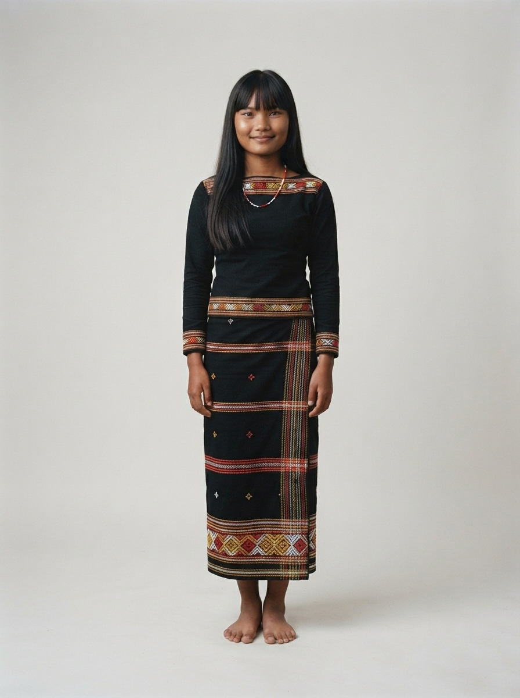

# 13 · Mondulkiri (មណ្ឌលគិរី)

| | |
|---|---|
| **Song** | មណ្ឌលគិរី ឋានសួគ៌ (Mondulkiri, Paradise), 3:55, tropical acoustic pop |
| **Avatar** | **Kiriya (គិរីយា)**, a fictional AI avatar: a young Bunong woman from the Mondulkiri highlands. She represents Mondulkiri in anything: singer, tour guide, assistant, host, ambassador |
| **Status** | ✅ avatar picked (look E), lyrics checked, guide facts drafted (to verify) |

 

> ⚠️ **AI disclosure:** Kiriya, her voice and every image here are AI-generated. She is fictional and does not
> show any real person. The song was **made with Suno** (see [song/rights.txt](./song/rights.txt)).

## The song
A road-trip song about leaving the busy city for the Mondulkiri highlands: waterfalls, sea-of-trees forests, grass hills,
elephants in a conservation project, local coffee and campfire nights. Listen: [song/mondulkiri-paradise.mp3](./song/mondulkiri-paradise.mp3). Lyrics: [song/lyrics.txt](./song/lyrics.txt).

## Kiriya
She is the face of Mondulkiri and can represent the province in anything: she sings its song, guides visitors,
answers questions, and hosts its events, lessons, campaigns and local products. Her
guide facts are in [province.md](./province.md). She sings with one bright, clear female voice. Her outfit draws on Bunong hand-weaving: an indigo-black wrap skirt with
red, white and yellow bands, a black blouse with red trim, bead necklaces and brass bangles. The owner approved this
dress for the province. Profile and rules: [avatar/profile.md](./avatar/profile.md).

## Files
- `avatar/`: face reference, full-body sheet, approved look, other looks (`looks/`), prompts,
  profile, `avatar.json`. To use her in new images (same face, any outfit), follow [../SKILL.md](../SKILL.md).
- `province.md`: guide and assistant facts (places, people, travel, responsible tourism)
- `song/`: the song ([mondulkiri-paradise.mp3](./song/mondulkiri-paradise.mp3), 5.3 MB, as exported from Suno), lyrics (as
  sung to Suno and spelling-corrected), rights record

## How to reuse
Everything here is licensed **CC BY 4.0** ([../LICENSE-MEDIA](../LICENSE-MEDIA)). Credit:
"Kiriya, CamboVerse Provinces — Mondulkiri, CamboVerse Center (CC BY 4.0). AI-generated character; song made with Suno."
Keep the AI disclosure when you republish her image. Do not present her as a real person or as a member of any real
community, and use her only for Mondulkiri. Never use her for a political party, candidate or cause, or for alcohol,
tobacco, gambling or weapons (full rules: [../SKILL.md](../SKILL.md)).
