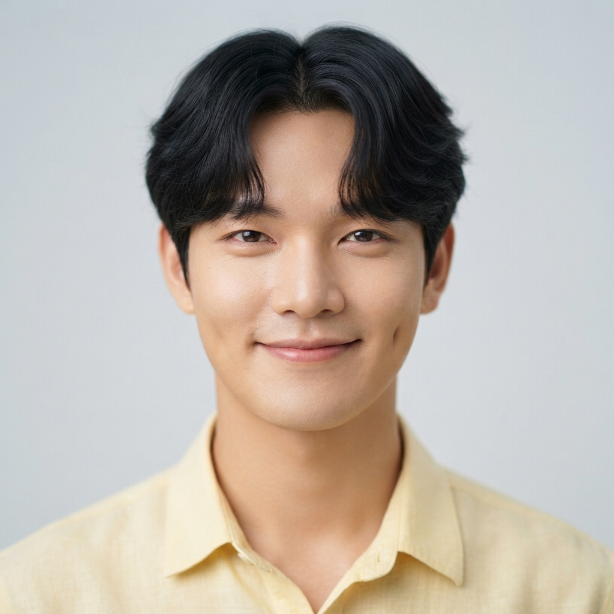
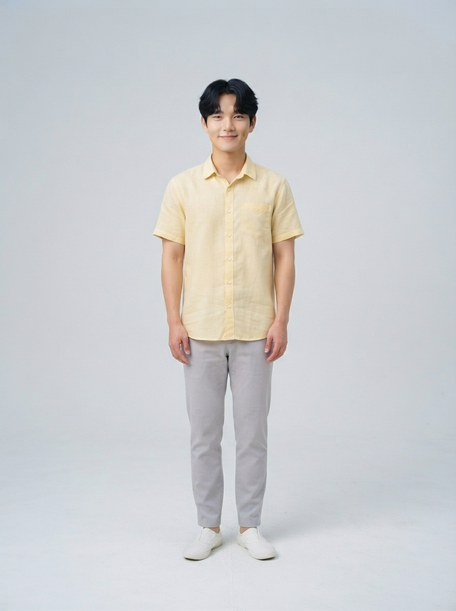

# 14 · Oddar Meanchey (ឧត្តរមានជ័យ)

| | |
|---|---|
| **Song** | ឧត្តរមានជ័យ ដែនដីដងរែក (Oddar Meanchey, Land of the Dangrek), 4:12, uplifting highland folk-pop with khloy and tro sau |
| **Avatar** | a fictional AI avatar (name to be chosen): a gentle, warm young Khmer man from Oddar Meanchey. He represents the province in anything: singer, tour guide, assistant, host, ambassador |
| **Status** | ✅ avatar picked (look C), lyrics checked, guide facts drafted (to verify) |

 

> ⚠️ **AI disclosure:** the avatar, his voice and every image here are AI-generated. He is fictional and does not
> show any real person. The song was **made with Suno** (see [song/rights.txt](./song/rights.txt)).

## The song
A warm, peaceful welcome to the far north: misty mornings on the Dangrek mountains, clear lakes, forest waterfalls,
old temples, country cooking, and the peace that now fills the land. Listen:
[song/oddar-meanchey-dangrek-land.mp3](./song/oddar-meanchey-dangrek-land.mp3). Lyrics:
[song/lyrics.txt](./song/lyrics.txt).

## The avatar
He is the face of Oddar Meanchey and can represent the province in anything: he sings its song, guides visitors,
answers questions, and hosts its events, lessons, campaigns and local products. His look is a pastel-yellow linen shirt
at a morning market. His guide facts are in [province.md](./province.md); his profile and rules are in
[avatar/profile.md](./avatar/profile.md).

## Files
- `avatar/`: face reference, full-body sheet, approved look, prompts, profile, `avatar.json`. To use him in new images
  (same face, any outfit), follow [../SKILL.md](../SKILL.md).
- `province.md`: guide and assistant facts (places, food, travel, safety, responsible tourism)
- `song/`: the song MP3 (as exported from Suno), lyrics (as given to Suno and spelling-corrected), rights record

## How to reuse
Everything here is licensed **CC BY 4.0** ([../LICENSE-MEDIA](../LICENSE-MEDIA)). Credit:
"The Oddar Meanchey avatar, CamboVerse Provinces — Oddar Meanchey, CamboVerse Center (CC BY 4.0). AI-generated character; song made with Suno."
Keep the AI disclosure when you republish his image. Do not present him as a real person, and use him only for Oddar Meanchey.
Never use him for a political party, candidate or cause, or for alcohol, tobacco, gambling or weapons (full rules:
[../SKILL.md](../SKILL.md)).
