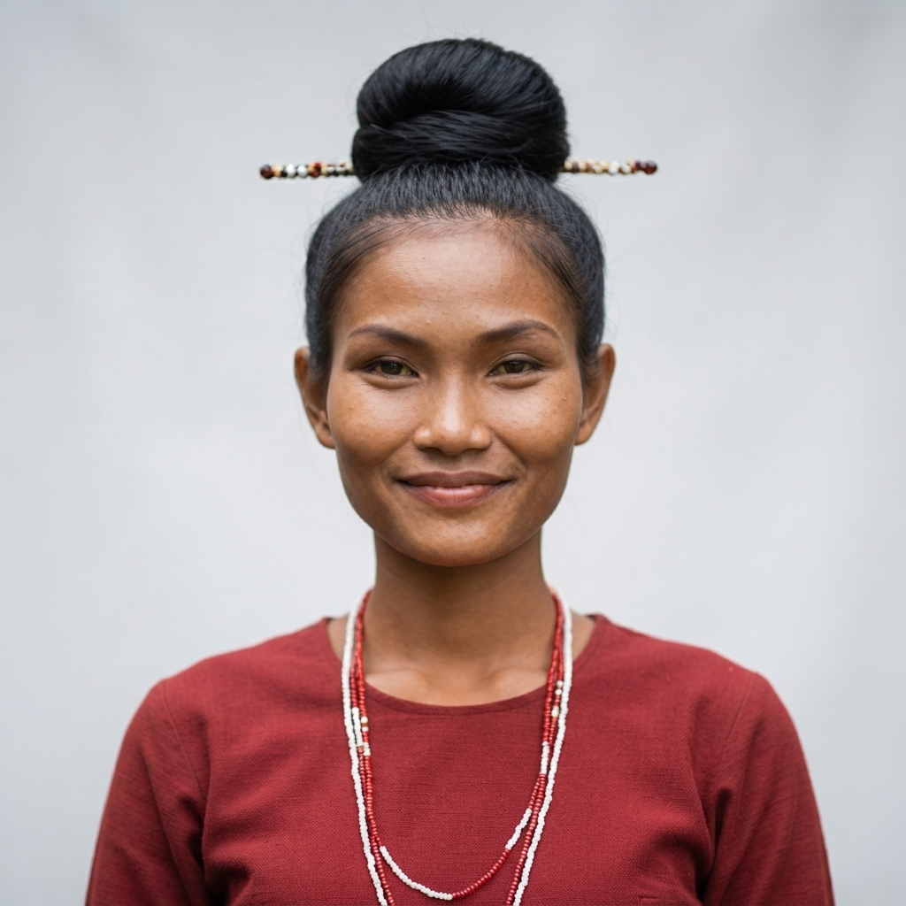
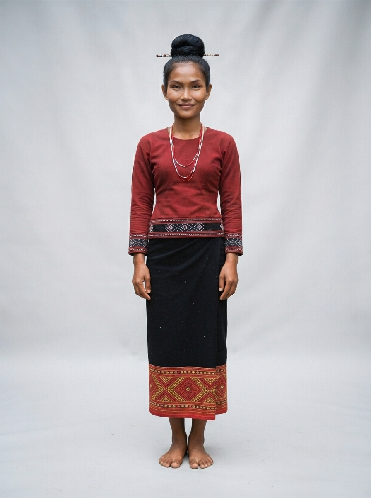

# 20 · Ratanakiri (រតនគិរី)

| | |
|---|---|
| **Song** | រតនគិរី ទឹកដីធម្មជាតិ (Ratanakiri, Land of Nature), 4:52, uplifting eco-folk with highland bamboo flute |
| **Avatar** | **Ratana (រតនា)**, a fictional AI avatar: a young Indigenous woman of the Ratanakiri highlands. She represents the province in anything: singer, tour guide, assistant, host, ambassador |
| **Status** | ✅ avatar picked (look B), lyrics checked, guide facts drafted (to verify) |

 

> ⚠️ **AI disclosure:** Ratana, her voice and every image here are AI-generated. She is fictional and does not
> show any real person or speak for any real community. The song was **made with Suno** (see
> [song/rights.txt](./song/rights.txt)).

## The song
A fresh highland invitation: the forest breeze, Yeak Laom's emerald crater lake, the Cha Ong and Ka Chanh waterfalls,
coffee and rubber farms, Indigenous culture, gong music by the fire and country food. Listen:
[song/ratanakiri-land-of-nature.mp3](./song/ratanakiri-land-of-nature.mp3). Lyrics: [song/lyrics.txt](./song/lyrics.txt).

## Ratana
She is the face of Ratanakiri and can represent the province in anything: she sings its song, guides visitors,
answers questions, and hosts its events, lessons, campaigns and local products. Her look is highland Indigenous dress,
worn with dignity, by a jungle waterfall; the owner chose traditional dress for this province, as for Mondulkiri. Her
guide facts are in [province.md](./province.md); her profile and rules are in [avatar/profile.md](./avatar/profile.md).

## Files
- `avatar/`: face reference, full-body sheet, approved look, prompts, profile, `avatar.json`. To use her in new images
  (same face, any outfit), follow [../SKILL.md](../SKILL.md).
- `province.md`: guide and assistant facts (places, people, travel, responsible tourism)
- `song/`: the song MP3 (as exported from Suno), lyrics (as given to Suno and spelling-corrected), rights record

## How to reuse
Everything here is licensed **CC BY 4.0** ([../LICENSE-MEDIA](../LICENSE-MEDIA)). Credit:
"Ratana, CamboVerse Provinces — Ratanakiri, CamboVerse Center (CC BY 4.0). AI-generated character; song made with Suno."
Keep the AI disclosure when you republish her image. Do not present her as a real person or as a member of any real
community, and use her only for Ratanakiri. Never use her for a political party, candidate or cause, or for alcohol,
tobacco, gambling or weapons (full rules: [../SKILL.md](../SKILL.md)).
