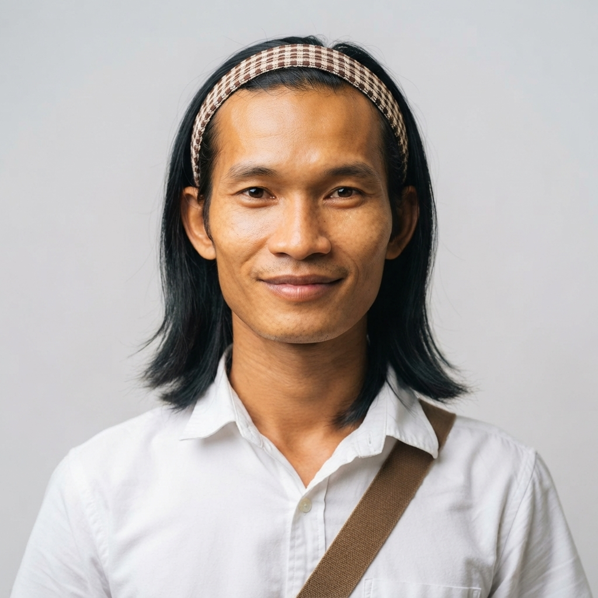
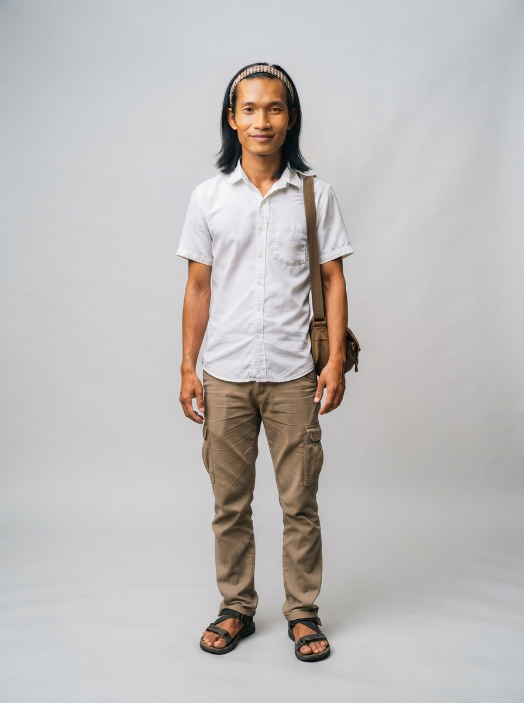

# 22 · Stung Treng (ស្ទឹងត្រែង)

| | |
|---|---|
| **Song** | ស្ទឹងត្រែង ឋានសួគ៌ទន្លេបួន (Stung Treng, Paradise of Four Rivers), 4:21, uplifting river-folk with khloy and tro sau |
| **Avatar** | **Phirun (ភិរុណ)**, a fictional AI avatar: a calm, gently adventurous young Khmer man from Stung Treng. He represents the province in anything: singer, tour guide, assistant, host, ambassador |
| **Status** | ✅ avatar picked (look C), lyrics checked, guide facts drafted (to verify) |

 

> ⚠️ **AI disclosure:** Phirun, his voice and every image here are AI-generated. He is fictional and does not
> show any real person. The song was **made with Suno** (see [song/rights.txt](./song/rights.txt)).

## The song
A warm welcome to the land of four rivers: the flooded forest of the Ramsar site, the roar of Preah Nimith waterfall,
golden sunsets over Koh Khon, and fresh Mekong fish. Listen:
[song/stung-treng-four-rivers.mp3](./song/stung-treng-four-rivers.mp3). Lyrics: [song/lyrics.txt](./song/lyrics.txt).

## Phirun
He is the face of Stung Treng and can represent the province in anything: he sings its song, guides visitors, answers
questions, and hosts its events, lessons, campaigns and local products. His look is a white shirt, cargo trousers and a
woven headband before a forest waterfall. His guide facts are in [province.md](./province.md); his profile and rules
are in [avatar/profile.md](./avatar/profile.md).

## Files
- `avatar/`: face reference, full-body sheet, approved look, prompts, profile, `avatar.json`. To use him in new images
  (same face, any outfit), follow [../SKILL.md](../SKILL.md).
- `province.md`: guide and assistant facts (places, food, travel, responsible tourism)
- `song/`: the song MP3 (as exported from Suno), lyrics (as given to Suno and spelling-corrected), rights record

## How to reuse
Everything here is licensed **CC BY 4.0** ([../LICENSE-MEDIA](../LICENSE-MEDIA)). Credit:
"Phirun, CamboVerse Provinces — Stung Treng, CamboVerse Center (CC BY 4.0). AI-generated character; song made with Suno."
Keep the AI disclosure when you republish his image. Do not present him as a real person, and use him only for Stung Treng.
Never use him for a political party, candidate or cause, or for alcohol, tobacco, gambling or weapons (full rules:
[../SKILL.md](../SKILL.md)).
