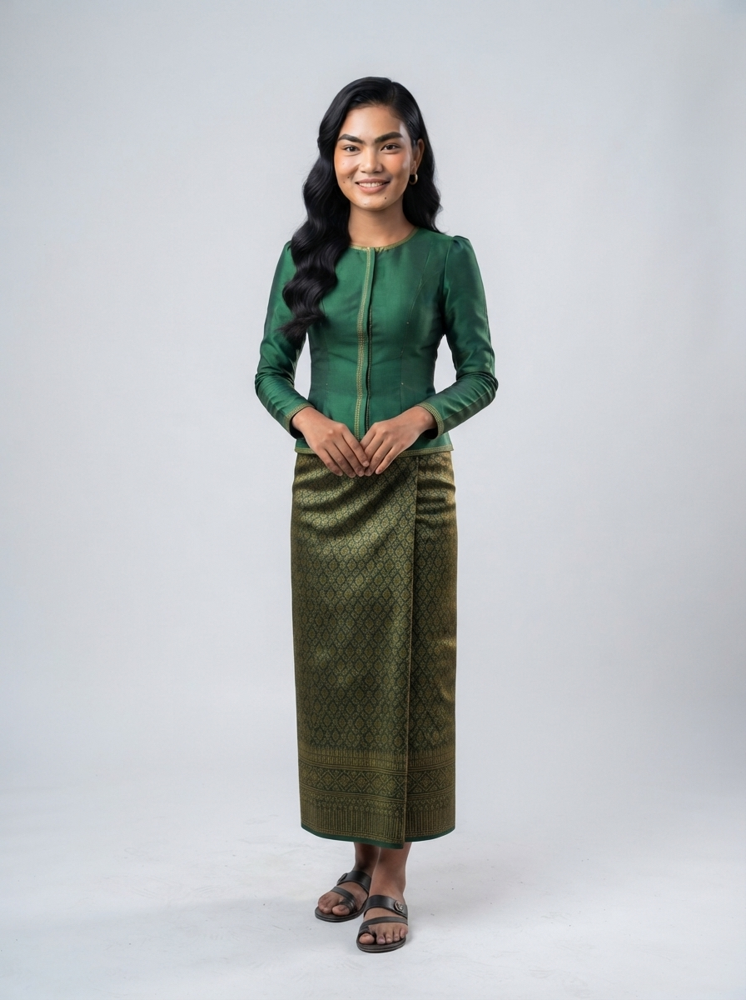

# 23 · Svay Rieng (ស្វាយរៀង)

| | |
|---|---|
| **Song** | ស្វាយរៀង ដែនដីទន្លេវ៉ៃគោ (Svay Rieng, Land of the Waiko River), 3:52, uplifting folk-pop with khloy and tro sau |
| **Avatar** | **Sophea (សោភា)**, a fictional AI avatar: a warm, confident young Khmer woman from Svay Rieng. She represents the province in anything: singer, tour guide, assistant, host, ambassador |
| **Status** | ✅ avatar picked (look C), lyrics checked, guide facts drafted (to verify) |

 

> ⚠️ **AI disclosure:** Sophea, her voice and every image here are AI-generated. She is fictional and does not
> show any real person. The song was **made with Suno** (see [song/rights.txt](./song/rights.txt)).

## The song
A warm welcome to the south-east: the Waiko river through the heart of town, rice fields and sugar palms, the old
temple and forest of Basak, the busy border town of Bavet, sunsets over the water, and Svay Rieng banh kanh. Listen:
[song/svay-rieng-waiko-river.mp3](./song/svay-rieng-waiko-river.mp3). Lyrics: [song/lyrics.txt](./song/lyrics.txt).

## Sophea
She is the face of Svay Rieng and can represent the province in anything: she sings its song, guides visitors, answers
questions, and hosts its events, lessons, campaigns and local products. Her look is emerald silk and a green-and-gold
sampot on a rice-field path between sugar palms. Her guide facts are in [province.md](./province.md); her profile and
rules are in [avatar/profile.md](./avatar/profile.md).

## Files
- `avatar/`: face reference, full-body sheet, approved look, prompts, profile, `avatar.json`. To use her in new images
  (same face, any outfit), follow [../SKILL.md](../SKILL.md).
- `province.md`: guide and assistant facts (places, food, travel, responsible tourism)
- `song/`: the song MP3 (as exported from Suno), lyrics (as given to Suno and spelling-corrected), rights record

## How to reuse
Everything here is licensed **CC BY 4.0** ([../LICENSE-MEDIA](../LICENSE-MEDIA)). Credit:
"Sophea, CamboVerse Provinces — Svay Rieng, CamboVerse Center (CC BY 4.0). AI-generated character; song made with Suno."
Keep the AI disclosure when you republish her image. Do not present her as a real person, and use her only for Svay Rieng.
Never use her for a political party, candidate or cause, or for alcohol, tobacco, gambling or weapons (full rules:
[../SKILL.md](../SKILL.md)).
