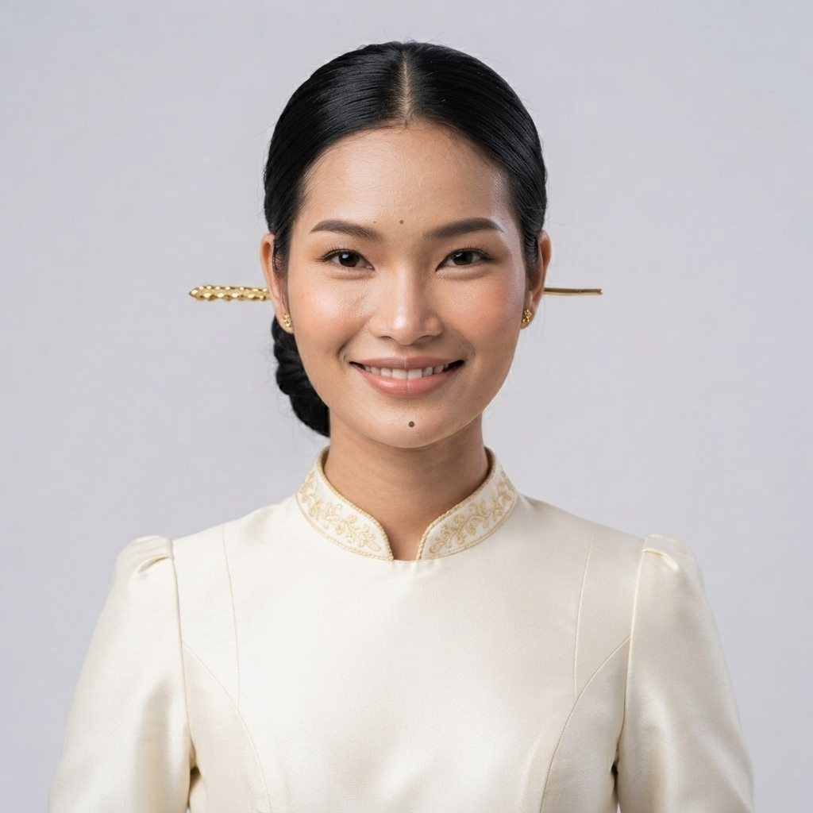

# 24 · Takeo (តាកែវ)

| | |
|---|---|
| **Song** | តាកែវ ទឹកដីប្រវត្តិសាស្ត្រ (Takeo, Land of History), 4:50, uplifting acoustic folk with khloy, tro sau and roneat |
| **Avatar** | a fictional AI avatar (name to be chosen): a graceful young Khmer woman from Takeo. She represents the province in anything: singer, tour guide, assistant, host, ambassador |
| **Status** | ✅ avatar picked (look D), lyrics checked, guide facts drafted (to verify) |

 

> ⚠️ **AI disclosure:** this avatar, her voice and every image here are AI-generated. She is fictional and does not
> show any real person. The song was **made with Suno** (see [song/rights.txt](./song/rights.txt)).

## The song
A proud invitation to a cradle of Khmer civilisation: ancient Funan, Phnom Da and Angkor Borei, the view from Phnom
Chisor, boat rides across the fields, hol and pidan silk, and grilled river prawns. Listen:
[song/takeo-land-of-history.mp3](./song/takeo-land-of-history.mp3). Lyrics: [song/lyrics.txt](./song/lyrics.txt).

## The avatar
She is the face of Takeo and can represent the province in anything: she sings its song, guides visitors, answers
questions, and hosts its events, lessons, campaigns and local products. Her look is ivory silk and a teal sampot on a
hilltop at sunset over the rice plains. Her guide facts are in [province.md](./province.md); her profile and rules are
in [avatar/profile.md](./avatar/profile.md).

## Files
- `avatar/`: face reference, full-body sheet, approved look, prompts, profile, `avatar.json`. To use her in new images
  (same face, any outfit), follow [../SKILL.md](../SKILL.md).
- `province.md`: guide and assistant facts (places, food, travel, responsible tourism)
- `song/`: the song MP3 (as exported from Suno), lyrics (as given to Suno and spelling-corrected), rights record

## How to reuse
Everything here is licensed **CC BY 4.0** ([../LICENSE-MEDIA](../LICENSE-MEDIA)). Credit:
"CamboVerse Provinces — Takeo, CamboVerse Center (CC BY 4.0). AI-generated character; song made with Suno."
Keep the AI disclosure when you republish her image. Do not present her as a real person, and use her only for Takeo.
Never use her for a political party, candidate or cause, or for alcohol, tobacco, gambling or weapons (full rules:
[../SKILL.md](../SKILL.md)).
